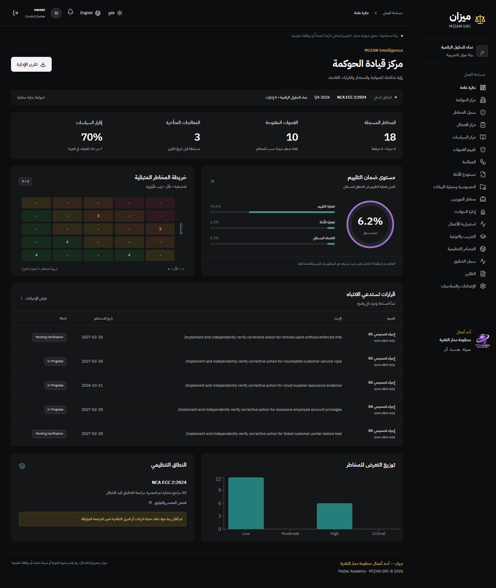
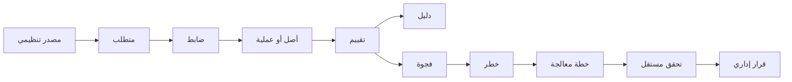
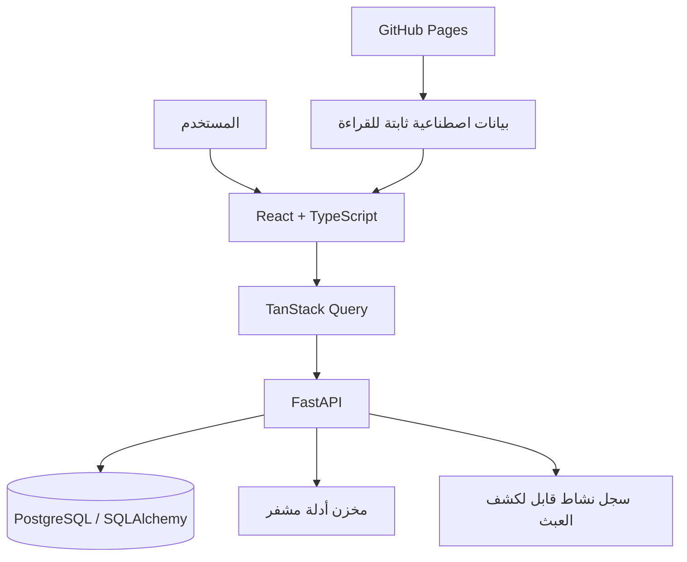

# ميزان | MIZAN GRC

### نظام تشغيل مؤسسي للحوكمة والمخاطر والامتثال والخصوصية

**منصة سعودية ثنائية اللغة تحول المتطلبات والسياسات والمخاطر والأدلة إلى قرارات مترابطة، قابلة للتتبع والمراجعة.**

[](https://github.com/ish3-is/MIZAN-GRC/actions/workflows/pages.yml)
[](https://github.com/ish3-is/MIZAN-GRC/actions/workflows/ci.yml)
[](LICENSE)

### [فتح العرض المباشر](https://ish3-is.github.io/MIZAN-GRC/) · [استعراض الصور](docs/portfolio/SCREENSHOT_GALLERY.md) · [قراءة دراسة الحالة](docs/CASE_STUDY.md)

**بيانات دخول العرض:** `admin` / `demo`

> نسخة GitHub Pages مخصصة للعرض الإداري، وتعمل ببيانات اصطناعية للقراءة فقط. المسارات المحفوظة، التشفير، رفع الأدلة، الاعتمادات والتدقيق الكامل تتطلب تشغيل FastAPI محليًا أو على خادم مؤسسي.



---

## الملخص التنفيذي

تساعد **ميزان** المنشآت على الانتقال من ملفات GRC المتفرقة إلى سجل قرار موحد يجيب عن الأسئلة التي تهم الإدارة والمراجعة:

- ما المتطلب أو السياسة التي بدأ منها القرار؟
- ما الأصل أو العملية أو المورد المتأثر؟
- من يملك الخطر أو الضابط أو الإجراء التصحيحي؟
- ما الدليل؟ وهل راجعه شخص مستقل؟
- ما الذي بقي مفتوحًا، وما المتأخر، وما الذي تم اعتماده؟

لا تعرض المنصة «نسبة امتثال» مجردة؛ بل تفصل بين **نطاق التقييم، تغطية الأدلة، التحقق المستقل، الفجوات والمخاطر المتبقية**.

### القيمة الإدارية

| القيمة | ما تقدمه ميزان |
|---|---|
| وضوح المساءلة | مالك ومراجع ومعتمد وتاريخ استحقاق لكل سجل تشغيلي |
| قرارات قابلة للدفاع | مبررات وأدلة وإصدارات وسجل نشاط مرتبط بالقرار |
| رؤية موحدة | الحوكمة والمخاطر والامتثال والخصوصية والتدقيق في مساحة واحدة |
| فصل المهام | منع المقيّم من اعتماد تقييمه عند اشتراط الاستقلالية |
| نزاهة تنظيمية | مصدر رسمي، إصدار، مرجع دقيق، حالة تحقق وتطبيق قانوني لكل مصدر |
| متابعة تنفيذية | مخاطر مرتفعة، فجوات مفتوحة، معالجات متأخرة وإقرارات سياسات |

## نطاق المحاكاة الحالية

جميع الأرقام التالية مولدة حتميًا من مؤسسة سعودية افتراضية باسم **نماء للحلول الرقمية**:

| المؤشر | القيمة |
|---|---:|
| الإدارات | 8 |
| الأصول المعلوماتية | 25 |
| المخاطر المؤسسية | 18 |
| الضوابط | 30 |
| تقييمات خط الأساس | 30 |
| السياسات | 16 سياسة بإصدارين عربي وإنجليزي |
| الموردون | 5 |
| الفجوات | 12 |
| إجراءات المعالجة | 12 |
| الأدوار الوظيفية | 10 |
| المصادر التنظيمية | 10 سجلات مصدر |

## سلسلة التتبع



## الوحدات المنفذة

| الوحدة | القدرات الحالية |
|---|---|
| مركز قيادة الحوكمة | مؤشرات محسوبة، خريطة 5×5، قرارات تستدعي الانتباه ونطاق تنظيمي |
| الحوكمة | الهيكل، النطاق، RACI، القرارات ومراجعات الإدارة |
| إدارة المخاطر | خطر كامن ومتبقٍ، شهية وتحمّل، معالجة، قبول ومراجعة دورية |
| تقييم الامتثال | تقييم ذاتي، أدلة، مراجعة مستقلة، اعتماد وإعادة تقييم |
| السياسات | 16 سياسة، إصدارات، مالك ومراجع ومعتمد وإقرارات واستثناءات |
| الخصوصية وPDPL | أنشطة معالجة، RoPA، تصنيف، نقل واحتفاظ وإشارات مراجعة قانونية |
| الأدلة | تشفير في النسخة الكاملة، SHA-256، صلاحية، إصدارات وتوقيع المراجع |
| الموردون | عناية واجبة، تقييم مخاطر، مراجعة تعاقدية وإعادة تقييم |
| الحوادث والاستمرارية | حوادث مترابطة وخدمات حرجة وأهداف تعافٍ ونتائج تمارين |
| التدقيق والتقارير | سجل نشاط مترابط، تقرير إدارة، CSV وحزمة تدقيق تجريبية |

## قصة تشغيل متكاملة

تحاكي البيانات السيناريو التالي:

1. اكتشاف مجموعة بيانات حساسة.
2. تحديد مالك البيانات ونطاق المعالجة.
3. تقييم قابلية تطبيق متطلبات الخصوصية.
4. تسجيل الخطر وتقييمه بمنهجية 5×5.
5. مراجعة الضوابط المرتبطة وطلب الأدلة.
6. فتح فجوة وتعيين إجراء تصحيحي بمالك وموعد.
7. تنفيذ الإجراء وإرساله للتحقق المستقل.
8. إعادة الاختبار وإصدار تقرير الإدارة.

## العرض المستضاف والنسخة الكاملة

| الخاصية | GitHub Pages | التشغيل الكامل |
|---|---|---|
| التصفح والفلاتر والتفاصيل | نعم | نعم |
| العربية RTL والإنجليزية LTR | نعم | نعم |
| البيانات الاصطناعية والتقارير التجريبية | نعم | نعم |
| حفظ التغييرات | لا، عرض للقراءة | نعم |
| قاعدة PostgreSQL | لا | نعم |
| رفع الأدلة وتشفيرها | لا | نعم |
| RBAC مفروض من الخادم | محاكاة عرض | نعم |
| سجل تدقيق محفوظ | لقطة اصطناعية | نعم |

تعتمد آلية النشر على المسار الرسمي لـGitHub Pages: بناء Vite، رفع artifact، ثم النشر الآلي عند الدفع إلى `main`.

## الفريق

تم تنفيذ المشروع بصورة تعاونية بين أعضاء **مدار**:

- **مشعل**
- **معاذ**
- **ريماس**
- **الجوري**

شارك الفريق في تحويل الفكرة إلى منتج يجمع بين التحليل التنظيمي، إدارة المخاطر، الخصوصية، تجربة المستخدم والهندسة البرمجية. لم يتم نشر توزيع فردي للأدوار، لذلك لا ينسب المستودع مساهمات غير موثقة إلى شخص بعينه.

## البنية التقنية



- **Frontend:** React 19، TypeScript، Vite، React Router، TanStack Query وRecharts.
- **Backend:** FastAPI، Pydantic، SQLAlchemy وAlembic.
- **Data:** PostgreSQL في Docker، مع SQLite للتطوير والاختبارات المحلية.
- **Security:** Argon2id، جلسات opaque، CSRF، CORS مقيد، RBAC، تحقق مدخلات وتشفير الأدلة.
- **Quality:** pytest، Vitest، Playwright، Ruff وGitHub Actions.

## الأساس التنظيمي

يحتفظ سجل المصدر داخل المنصة بالناشر والرابط الرسمي والعنوان والإصدار وتاريخ التحقق والمرجع الدقيق وحالة التحقق والتطبيق القانوني والتفسير ومتطلبات الأدلة.

تشمل البداية المختارة:

- ضوابط الأمن السيبراني الأساسية NCA ECC 2:2024.
- نظام حماية البيانات الشخصية السعودي PDPL ومواده التنظيمية ذات الصلة.
- سجلات مرجعية محدودة لـISO/IEC 27001 و27002 و27701 دون إعادة توزيع النصوص المملوكة.

كل عنصر لم يكتمل التحقق منه يظهر بوضوح كـ`UNVERIFIED`. ميزان يدعم إدارة الامتثال، ولا يمنح شهادة أو اعتمادًا تنظيميًا أو رأيًا قانونيًا.

## التحقق المنفذ

- 17 اختبار Backend ناجحًا.
- اختبارا Frontend ناجحان.
- سيناريو Playwright متكامل للتقييم والدليل والمراجعة المستقلة.
- اختبار مستقل يبني معرض الصور الكامل دون تعديل السجلات.
- بناء إنتاجي وفحص Ruff وسجل مصادر منظم.

النتائج التفصيلية والقيود موثقة في [سجل التحقق](docs/VERIFICATION.md). لا يُذكر أي اختبار على أنه ناجح ما لم يتم تشغيله فعليًا.

## تشغيل النسخة الكاملة على Windows

### باستخدام Docker

```powershell
./scripts/bootstrap.ps1
docker compose up --build
```

ثم افتح: [http://localhost:8080](http://localhost:8080)

### تشغيل محلي مباشر

```powershell
./scripts/bootstrap.ps1
./scripts/start-local.ps1 backend
./scripts/start-local.ps1 frontend
```

ثم افتح: [http://localhost:5173](http://localhost:5173)

كلمة المرور المحلية تُنشأ داخل `.env` ولا تُرفع إلى GitHub.

## بنية المستودع

```text
backend/       FastAPI، النماذج، الصلاحيات، التشفير والمهاجرات
frontend/      React، التصميم الثنائي اللغة ووضع GitHub Pages
regulatory/    سجل المصادر المنظمة وبيانات التحقق
docs/          المعمارية والمنهجيات والسياسات ودراسة الحالة والصور
scripts/       التهيئة، إعادة الضبط، التحقق وتصدير نسخة Pages
.github/       التحقق المستمر والنشر الآلي
```

## وثائق الإدارة والمراجعة

- [المعمارية](docs/ARCHITECTURE.md)
- [منهجية المخاطر والامتثال](docs/METHODOLOGY.md)
- [مصفوفة RACI](docs/RACI.md)
- [دراسة الحالة](docs/CASE_STUDY.md)
- [سجل المصادر التنظيمية](docs/REGULATORY.md)
- [الأمن ونموذج التهديد](docs/SECURITY.md)
- [حالة التنفيذ الصادقة](docs/IMPLEMENTATION_CHECKLIST.md)
- [معرض من 26 شاشة](docs/portfolio/SCREENSHOT_GALLERY.md)

## حدود الاستخدام

- البيانات والموظفون والحوادث والموردون في العرض **اصطناعيون بالكامل**.
- لا يدعي المشروع تغطية كاملة لـECC أوPDPL.
- لا تستبدل التفسيرات مراجعة المختص القانوني أو الجهة المنظمة.
- GitHub Pages واجهة عرض ثابتة وليست بيئة إنتاج أو مخزن أدلة.
- يجب تطبيق إدارة أسرار ومفاتيح وتخزين مؤسسي ومراقبة إضافية قبل أي استخدام إنتاجي.

## الترخيص

الشفرة الأصلية متاحة وفق [MIT License](LICENSE). تبقى أسماء الجهات والمعايير والنصوص التنظيمية ومواد الأطراف الثالثة خاضعة لحقوق أصحابها وشروط استخدامها.

---

## English brief

MIZAN GRC is an Arabic-first, bilingual governance, risk, compliance and privacy operating-system demonstrator for Saudi organizations. The GitHub Pages deployment is a read-only synthetic showcase; persisted workflows, encrypted evidence, server-enforced authorization and full audit operations require the FastAPI backend. Internal assessment is not certification, regulatory approval or legal advice.
