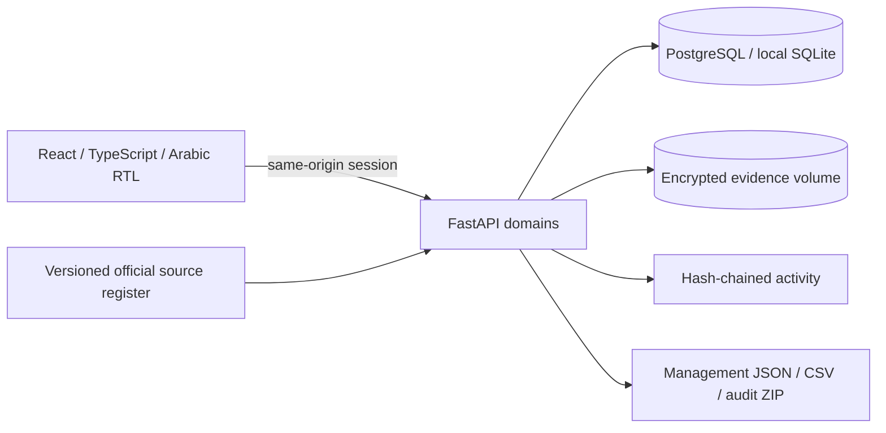
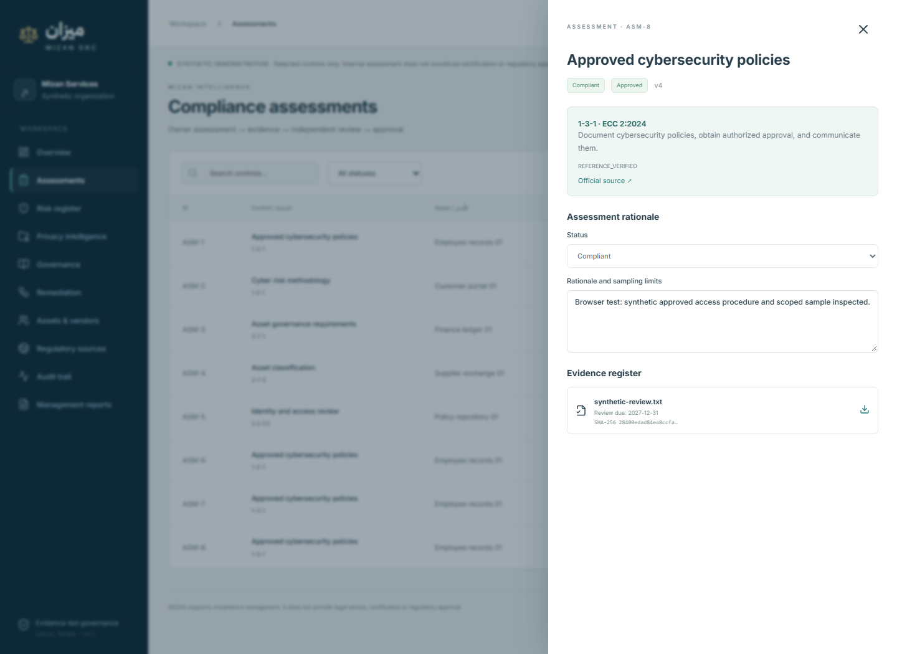

# ميزان | MIZAN GRC

**Saudi-first governance, risk, compliance and privacy intelligence.**

**أحد أعمال منظومة مدار التقنية | A project by MaDar Academy.**

Dark mode defaults to midnight navy with restrained violet and gold accents inspired by the supplied MaDar identity. A bilingual appearance toggle on sign-in and in the workspace saves the chosen light/dark mode locally. The supplied original logo is used without modification.

منصة تجريبية مهنية لإدارة الحوكمة والمخاطر والامتثال والخصوصية، بواجهة عربية واتجاه RTL، وسير تقييم محفوظ وقابل للتدقيق. جميع بيانات المنشأة اصطناعية.

**Release 0.1: working assessment-to-remediation vertical slice, with explicitly limited scope.** This repository does not claim complete ECC/PDPL coverage, production readiness, certification, regulatory approval or legal advice. Governance and privacy are currently **read-only baseline registries**, not finished workflow modules.


## What works

* Eight server-enforced roles, Argon2id password hashing, opaque sessions, CSRF header and origin checks.
* Selected NCA ECC references with publication metadata, exact IDs, verification states and interpretation caveats.
* Create assessment → record rationale → attach encrypted evidence → submit → independent review → approval/return.
* Register linked risk and finding → assign action → progress remediation → reassess → independent retest → close.
* Independent inherent and residual 5×5 ratings, narrative effectiveness rationale and controlled risk acceptance.
* Encrypted evidence with SHA-256 integrity verification, freshness dates and authenticated download.
* Tamper-evident activity chain, scoped management JSON, UTF-8 CSV, and authorized audit ZIP containing evidence and manifest hashes.
* Arabic/English navigation, RTL/LTR, responsive tables and risk heatmap calculated from persisted data.

The seed provides **5 departments, 25 information assets, 40 risks, 10 vendors, 5 selected ECC references, 5 baseline assessments, 5 policy drafts, 5 incomplete processing records and 1 discovery case**. Fictional records are synthetic scenarios, not actual regulatory findings.

## Run on Windows

Docker path (prepared; Docker engine was unavailable during this delivery):

```powershell
./scripts/bootstrap.ps1
docker compose up --build -d
```

Open [localhost:8080](http://localhost:8080). Read `DEMO_PASSWORD` from ignored `.env`. Accounts: `owner`, `auditor`, `manager`, `risk`, `privacy`, `compliance`, `executive`, `admin`. All credentials are generated locally and are for nonproduction use only. Never commit `.env` or evidence keys.

Verified native fallback:

```powershell
python -m venv .venv
./.venv/Scripts/python -m pip install -r backend/requirements.txt
./scripts/bootstrap.ps1
cd frontend
npm ci
cd ..
./scripts/start-local.ps1 backend
```

In a second terminal:

```powershell
./scripts/start-local.ps1 frontend
```

Open [localhost:5173](http://localhost:5173). If `.env` already exists, skip bootstrap; it deliberately refuses to overwrite encryption keys. Detailed startup, seed reset and backup guidance: [operations](docs/OPERATIONS.md).

## Try the working flow

1. Sign in as `owner`. Open **Assessments / التقييم والامتثال** and inspect a control's official source and verification state.
2. Create an assessment or open a draft. Record a rating and rationale, save, and attach a **synthetic** TXT/CSV/PDF/PNG file with an organizational review date.
3. Submit for independent review. In **Remediation / المعالجة والتحسين**, register a gap linked to the assessment, a risk and an accountable owner.
4. In a separate browser session, sign in as `auditor`, inspect evidence and approve or return the assessment conclusion. A verified Non-Compliant conclusion remains noncompliant.
5. Owner progresses the finding, reopens the approved assessment, records correction and evidence, submits for retest. Independent auditor approves the compliant conclusion and closes the finding.
6. Export the management report or CSV. An auditor can download `/api/reports/audit-pack.zip` and verify its manifest. Inspect **Audit trail / سجل التدقيق** and verify the chain.

No paid AI is needed. No automatic compliance certification or invented PDPL deadlines are present.

## Architecture



Stack: React 19, TypeScript, Vite, TanStack Query, React Router, Recharts, plain CSS design tokens; Python 3.12, FastAPI, Pydantic, SQLAlchemy, Alembic, PostgreSQL; Docker Compose; pytest, Vitest, Playwright and GitHub Actions. Single organization per deployment. No tenant-isolation claim. [Architecture, ERD and data flow](docs/ARCHITECTURE.md) · [Threat model and RBAC](docs/SECURITY.md).

## Regulatory integrity

The selected starter references were checked in [NCA's official ECC 2:2024 English PDF](https://cdn.nca.gov.sa/api/files/public/upload/86e09090-44e4-481f-bc28-355673607654_ECC--2024-EN.pdf). The Arabic text governs meaning; specialist interpretation and organization applicability approval are pending. ECC adoption is an organizational benchmark in this synthetic organization, not an unsupported claim of mandatory applicability.

SDAIA PDPL, implementing regulation, transfer and historical NDMO source records are **UNVERIFIED at requirement/current-applicability level**. No article obligations or statutory timers are activated. ISO's official catalogue identifies [ISO/IEC 27701:2025](https://www.iso.org/standard/27701); only publication metadata is recorded, without proprietary clause text. No invented cross-framework equivalences are seeded.

[Source register and review procedure](docs/REGULATORY.md) · [Machine-readable provenance](regulatory/sources.json) · [Risk and scoring methodology](docs/METHODOLOGY.md).

## Executed verification

See [verification record](docs/VERIFICATION.md) for exact results and limitations. Commands:

```powershell
./.venv/Scripts/python -m pytest backend/tests -q
./.venv/Scripts/python scripts/verify-register.py
cd frontend
npm test
npm run build
npm run test:e2e
```

Browser tests require running native services and mutate the demo by adding an assessment. Unit/API tests use an isolated temporary database. Docker/PostgreSQL, load/performance, independent penetration testing and a complete accessibility audit remain unverified.

## Portfolio documentation

* [Requirements and acceptance scope](docs/REQUIREMENTS.md)
* [Phase delivery record and remaining work](docs/PHASES.md)
* [Synthetic investigation case study](docs/CASE_STUDY.md)
* [API contract](docs/API.md) and generated [OpenAPI snapshot](docs/openapi.json)
* [Release notes](docs/RELEASE_NOTES.md)
* [Demo and interview walkthroughs, CV description and launch copy](docs/PORTFOLIO.md)



## حدود النطاق

هذه النسخة تنفذ مساراً عملياً للتقييم والأدلة والمخاطر والفجوات والمعالجة والمراجعة المستقلة والتصدير. سجلات الخصوصية والسياسات أساسية وللقراءة فقط. لم يُنفذ بعد سير طلبات أصحاب البيانات أو الإخطار بالتسرب أو تقييم النقل أو اعتماد السياسات، ولم تُفعّل مهل نظامية غير متحقق منها. لا تستخدم بيانات شخصية حقيقية. خطوات التشغيل والتجربة موثقة أعلاه، وكلمة المرور تُنشأ محلياً ولا تُنشر في المستودع.

## Licensing

Original project code is MIT licensed. Publisher documents, names, marks and linked standards retain their respective rights. No claim of regulator affiliation or endorsement. Do not redistribute proprietary ISO/COBIT text under the project license. Source excerpts are intentionally omitted.
