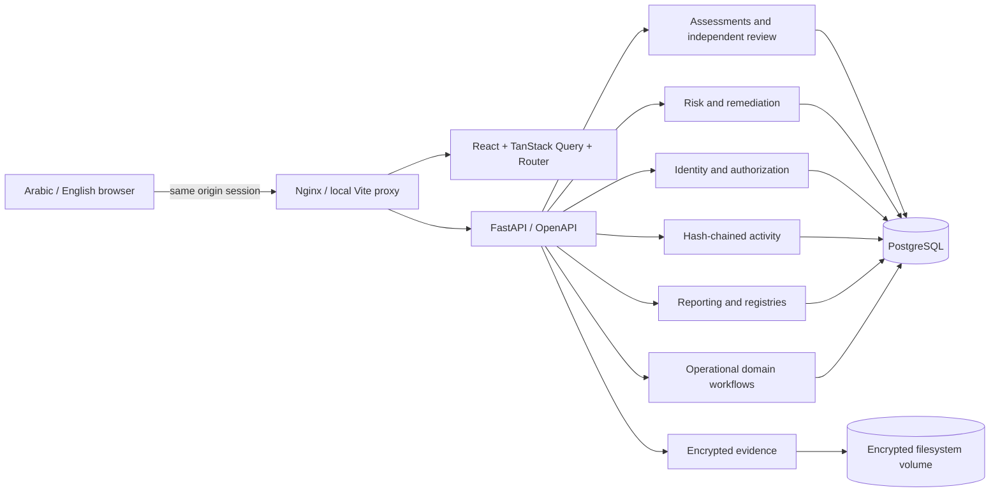
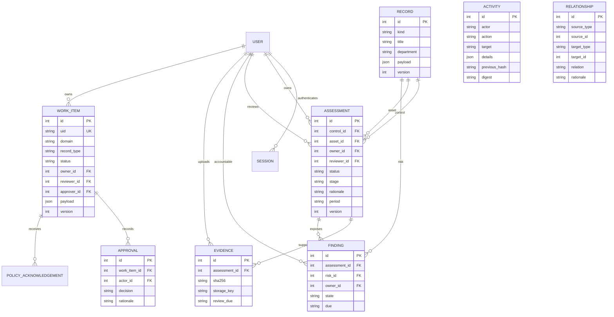

# MIZAN architecture and critical decisions

Status: operating-system simulation v0.2, 12 November 2026. This is a single-organization portfolio demonstrator, not an enterprise production release.

## Critical architecture plan

1. Regulatory provenance is separate from legal applicability. Record access, exact-reference inspection and specialist interpretation as distinct states. Never infer statutory deadlines from generic task due dates.
2. Build the assessment-to-remediation workflow first, then add a shared operational-record kernel for governance, policy, privacy, supplier, incident, continuity, training and audit domains. A domain is presented as writable only when its transitions and authorization rules exist.
3. Serve React and FastAPI on one browser origin. Use opaque server-side sessions, HttpOnly cookies and a required custom mutation header. Do not store tokens in browser storage.
4. Run one API worker in the initial single-organization deployment. PostgreSQL serializes activity-chain writes using an advisory transaction lock; affected workflow rows use row locks. SQLite is the local verification fallback, not the production concurrency target.
5. Persist core assessment/evidence relationships with foreign keys. Versioned work items normalize ownership, review, approval, due date, lifecycle and history while retaining domain-specific fields in JSON. Explicit relationship edges record cross-domain rationale and review. Further normalization is still required for large production deployments.
6. Encrypt evidence before filesystem writes; use opaque names, authenticated encryption and plaintext SHA-256 integrity verification. Keep the encryption key outside Git. Database and evidence backup consistency matters.
7. Reserve legal interpretation, applicability approval, mapping equivalence and final decisions for authorized humans. No AI API dependency.

## Component diagram



## Current ERD



## Extended target model

Organization → department / process / asset / vendor; framework → source revision → requirement; requirement ↔ control through reviewed mappings; control ↔ asset/process; assessment → immutable assessment revision → evidence version → reviewer signoff; finding → risk → treatment → approval; privacy inventory → processing activity → PIA / rights / breach / transfer case. Reports snapshot scope and source revisions. Every cross-framework mapping stores intent overlap, exclusions, reviewer and review date. Similar titles alone never establish equivalence.

The current app has one deployment per organization. It has no tenant identifier and must not be marketed or used as multi-tenant software. The database credential is an application service identity; end-user authorization lives in FastAPI. PostgreSQL row-level security is not implemented.

## Data-flow and trust boundaries

```mermaid
sequenceDiagram
  actor Owner
  actor Auditor
  participant Browser
  participant API
  participant DB
  participant Vault as Evidence volume
  Owner->>Browser: Enter rating and rationale
  Browser->>API: Session + CSRF header + expected version
  API->>DB: Validate role, owner and workflow state
  API->>DB: Save rating and hash-chained activity
  Owner->>API: Upload synthetic evidence
  API->>Vault: Authenticated ciphertext under opaque name
  API->>DB: Evidence digest and review date
  Owner->>API: Submit
  Auditor->>API: Download and inspect evidence
  API->>Vault: Decrypt and verify digest
  Auditor->>API: Independent approval with rationale
  API->>DB: Reject self-approval; persist reviewer and event
  API->>Browser: Scoped report with source references
```

## Operational decisions

No Redis or background scheduler in v0.2. Overdue findings, remediation and evidence freshness are calculated at request time; no emails or notification delivery is claimed. No paid AI or automatic legal conclusions. No separate requirement table yet: selected starter control provenance is embedded in control documents. No standards text is redistributed. External Google Fonts are optional presentation dependencies; system fallbacks work offline. Self-host fonts before restricted-network use.

Frontend uses plain CSS tokens rather than Tailwind. FastAPI route modules separate identities, compliance, risk, remediation, evidence, operational domains, audit, reporting and registries; shared authentication and audit primitives live in `core.py`. Governance and privacy use the versioned operational kernel. The React workspace is still a single component module; domain component extraction and dedicated service/repository layers are required before production scale. These choices prioritize an inspectable, tested release while explicitly limiting architectural claims.
